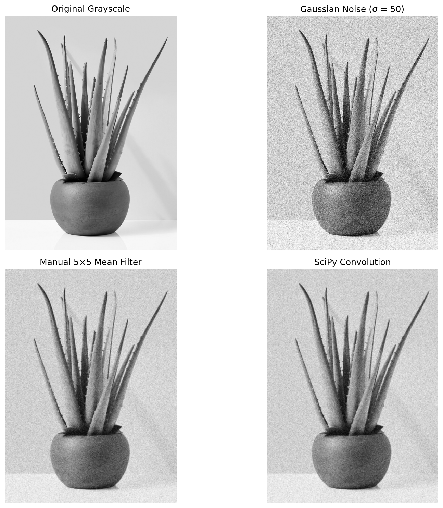
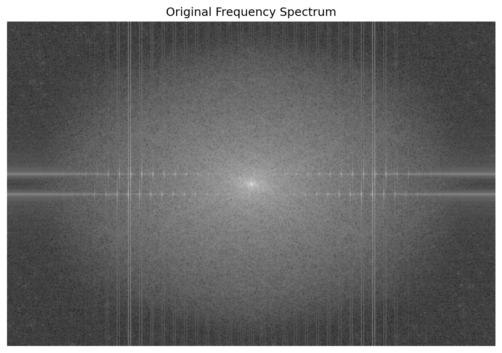
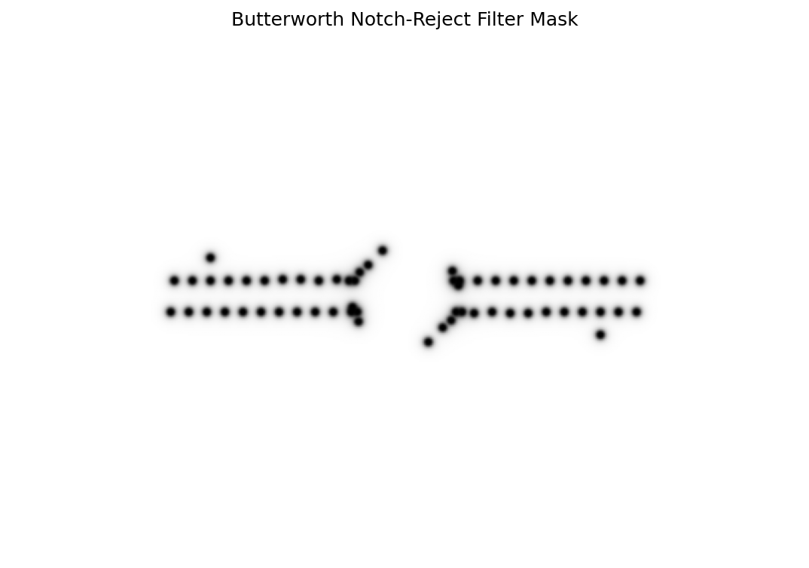
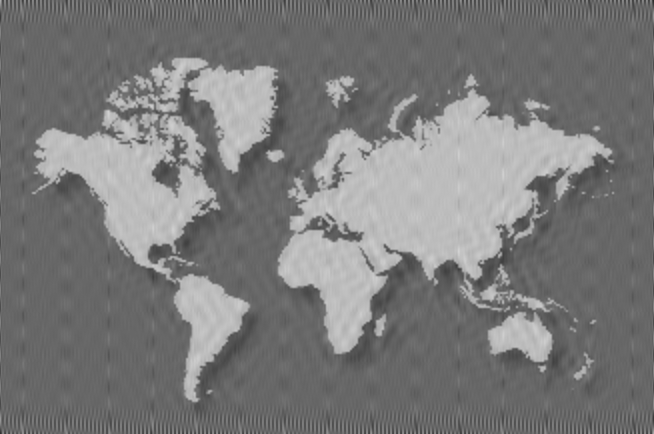

# Digital Image Processing Project

University project reimplementation for the **Digital Image Processing Laboratory**, based on the original course assignment.

The project demonstrates fundamental image-processing techniques using Python and Jupyter Notebook, covering both spatial-domain and frequency-domain processing.

---

## Overview

The implementation includes:

- RGB and HSV color-space analysis
- Grayscale and binary image conversion
- Histogram-based segmentation
- Geometric image transformations
- Gaussian-noise generation
- Manual 5×5 mean filtering
- Convolution using SciPy
- Connected-component labeling with 8-connectivity
- South America extraction
- Fourier-spectrum analysis
- Periodic-noise removal using a Butterworth notch-reject filter

The project is intentionally implemented as a **university-level Digital Image Processing exercise**, remaining close to the scope of the original assignment.

---

## Input Images

Two images provided with the original assignment are used:

### Aloe Plant and Pot

`images/aloe-plant-pot.jpg`

Used for:

- RGB / HSV analysis
- grayscale conversion
- binary conversion
- histogram analysis
- pot segmentation
- geometric transformations
- Gaussian-noise experiments
- mean filtering

### Noisy World Map

`images/noise_world_map.png`

Used for:

- binary segmentation
- connected-component labeling
- South America extraction
- Fourier-domain analysis
- periodic-noise removal

---

## Main Tasks

### 1. Color Spaces

The aloe image is analyzed in:

- RGB
- HSV

The individual channels are displayed separately to illustrate their contribution to the image.

---

### 2. Grayscale and Binary Conversion

The RGB image is converted to grayscale and then to a binary image using intensity thresholding.

---

### 3. Histogram-Based Pot Segmentation

The grayscale histogram is analyzed to determine an appropriate intensity range for the plant pot.

The selected mask is refined and used to isolate the pot against a white background.


---

### 4. Geometric Transformations

The grayscale image is processed using:

- transposition
- resizing to `300 × 255`
- 45° counter-clockwise rotation

Generated files:

```text
results/transformations/grayscale_transposed.png
results/transformations/grayscale_resized.png
results/transformations/grayscale_rotated_45.png
```

---

### 5. Gaussian Noise

Gaussian noise is added to the grayscale image using:

\[
\mu = 0
\]

and:

\[
\sigma = 50
\]

A fixed random seed is used to make the generated result reproducible.

---

### 6. Manual 5×5 Mean Filter

A 5×5 arithmetic averaging filter is implemented manually without using a ready-made convolution function.

The filter kernel is:

\[
H=
\frac{1}{25}
\begin{bmatrix}
1&1&1&1&1\\
1&1&1&1&1\\
1&1&1&1&1\\
1&1&1&1&1\\
1&1&1&1&1
\end{bmatrix}
\]

The implementation explicitly processes every local 5×5 image neighborhood.

---

### 7. SciPy Convolution

The same averaging mask is applied using:

```python
scipy.ndimage.convolve
```

The manual and SciPy results are numerically compared.

The observed differences are only at floating-point precision level:

```text
Maximum absolute difference ≈ 1.7 × 10⁻13
Mean absolute difference    ≈ 2.6 × 10⁻14
```

This verifies that the manual filtering implementation behaves equivalently to the SciPy convolution operation.



---

### 8. Connected-Component Labeling

The noisy world map is converted into a binary land mask.

Connected-component labeling is applied using **8-connectivity**.

This allows individual connected land regions to be identified and the component corresponding to South America to be extracted.


---

### 9. Periodic Noise Removal

The world-map image contains periodic interference.

A two-dimensional Fourier transform is used to inspect the frequency spectrum.

Strong periodic-noise frequencies appear as symmetric spectral peaks.

A **Butterworth notch-reject filter** is then constructed to attenuate these frequencies while preserving the remaining image information.

### Frequency Spectrum



### Butterworth Notch-Reject Mask



### Final Denoised Map



---

## Project Structure

```text
digital-image-processing-project/
│
├── docs/
│   └── report.md
│
├── images/
│   ├── aloe-plant-pot.jpg
│   └── noise_world_map.png
│
├── notebooks/
│   └── digital_image_processing_project.ipynb
│
├── results/
│   ├── filtering/
│   │   ├── filtering_comparison.png
│   │   ├── gaussian_noise_std50.png
│   │   ├── manual_mean_filter_5x5.png
│   │   └── scipy_mean_filter_5x5.png
│   │
│   ├── frequency_domain/
│   │   ├── butterworth_notch_mask.png
│   │   ├── original_frequency_spectrum.png
│   │   └── world_map_denoised.png
│   │
│   ├── segmentation/
│   │   ├── pot_segmentation.png
│   │   └── south_america_extraction.png
│   │
│   └── transformations/
│       ├── grayscale_resized.png
│       ├── grayscale_rotated_45.png
│       └── grayscale_transposed.png
│
├── .gitignore
├── README.md
└── requirements.txt
```

---

## Technologies

- Python
- Jupyter Notebook
- NumPy
- Matplotlib
- Pillow
- SciPy

---

## Installation

Clone the repository and install the required dependencies:

```bash
pip install -r requirements.txt
```

Then open:

```text
notebooks/digital_image_processing_project.ipynb
```

---

## Running the Project

The notebook is designed to execute sequentially from a clean kernel.

Use:

```text
Restart Kernel → Run All
```

The notebook uses relative paths and automatically creates the main generated outputs under the corresponding `results/` directories.

---

## Reproducibility

A fixed random seed is used for Gaussian-noise generation.

This ensures that repeated executions of the notebook produce the same noise realization and consistent filtering results.

---

## Documentation

A more detailed description of the methodology, theory, and individual assignment questions is available in:

```text
docs/report.md
```

---

## Project Context

This repository contains a **reimplementation of the original university Digital Image Processing assignment**.

The original source code is no longer available, so the project was recreated from the original assignment requirements and supplied image files.

It is not presented as the byte-for-byte original university submission.

The implementation remains intentionally close to the educational scope of the original course project.